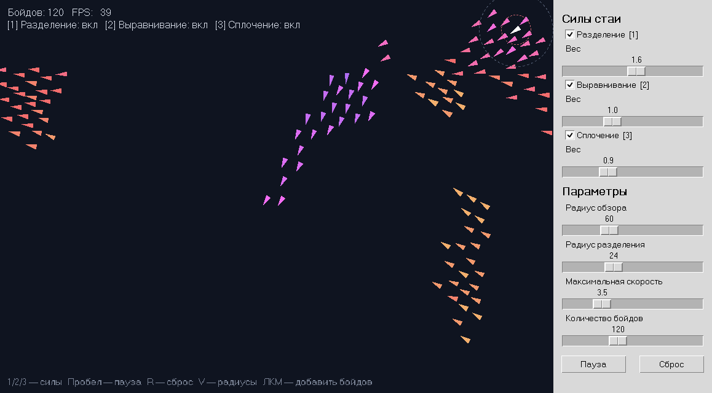
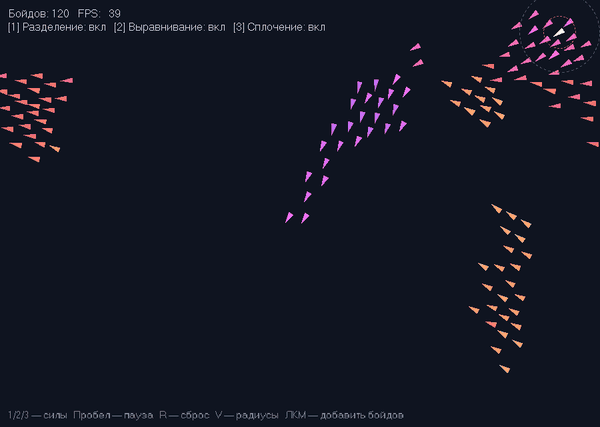

# Бойды — моделирование стайного поведения

**Автор:** Черенков Сергей Сергеевич

**Группа:** ПИ25-1

**Дисциплина:** —

**Дата сдачи:** —

## Описание проекта

Программа моделирует поведение стаи птиц по алгоритму «Бойды» Крейга Рейнольдса.
Каждый бойд видит только ближайших соседей и подчиняется трём простым правилам:
разделению, выравниванию и сплочению. Из этих локальных правил возникает сложное
коллективное движение: бойды собираются в стаи, разлетаются и снова объединяются.
Силы можно включать и выключать с клавиатуры, а их веса регулировать слайдерами.

Работа выполнена по заданию «Бойды» из лабораторной работы №2 «Сложная анимация».

## Функциональные возможности

### Основной функционал

- 🐦 Стая бойдов со случайными начальными положениями и случайной, но плавной начальной скоростью
- ↔️ Разделение: бойды не подлетают друг к другу слишком близко
- ➡️ Выравнивание: бойды поворачивают в сторону полёта соседей
- 🎯 Сплочение: бойды держатся ближе к центру группы соседей
- 🌐 Тороидальный мир: вылетевший за край бойд появляется с противоположной стороны, соседи тоже ищутся «через край»
- 🎨 Цвет бойда зависит от направления полёта, поэтому стаи хорошо различимы

### Дополнительный функционал

- ⌨️ Включение и выключение каждой из трёх сил клавишами `1`, `2`, `3` (доп. задание 1)
- 🎚️ Регулировка весов трёх сил слайдерами (доп. задание 2)
- ⚙️ Слайдеры радиуса обзора, радиуса разделения, максимальной скорости и количества бойдов
- 🖱️ Добавление бойдов щелчком мыши
- 👁️ Показ радиусов обзора и разделения у выделенного (белого) бойда
- ⏸️ Пауза и сброс стаи
- ⚡ Быстрый поиск соседей через пространственную сетку вместо перебора всех пар
- ✅ Модульные тесты математической модели

## Демонстрация работы программы

### Главное окно



### Анимация



## Требования к системе

- **Python:** 3.9 или выше
- **Операционная система:** Windows / macOS / Linux
- **Библиотеки:** только стандартная библиотека Python
  - `tkinter` (встроенная) — окно, холст, слайдеры
  - `math`, `random`, `colorsys`, `dataclasses`, `time` — расчёты
  - `unittest` — тесты

> На Linux tkinter иногда нужно поставить отдельно: `sudo apt install python3-tk`.

## Установка и запуск

### 1. Клонирование репозитория

```bash
git clone https://github.com/meganaibator2007/boids-simulation.git
cd boids-simulation
```

### 2. Создание и активация виртуального окружения

Windows:

```bash
python -m venv venv
venv\Scripts\activate
```

macOS/Linux:

```bash
python3 -m venv venv
source venv/bin/activate
```

### 3. Установка зависимостей

```bash
pip install -r requirements.txt
```

Внешних зависимостей нет, команда нужна для единообразия запуска.

### 4. Запуск программы

```bash
python main.py
```

### 5. Управление

| Действие | Клавиша / элемент |
|---|---|
| Включить / выключить разделение | `1` или флажок «Разделение» |
| Включить / выключить выравнивание | `2` или флажок «Выравнивание» |
| Включить / выключить сплочение | `3` или флажок «Сплочение» |
| Изменить вес силы | слайдер «Вес» под флажком силы |
| Пауза / продолжить | `Пробел` или кнопка «Пауза» |
| Сбросить стаю | `R` или кнопка «Сброс» |
| Показать / скрыть радиусы | `V` |
| Добавить 5 бойдов | щелчок левой кнопкой мыши по полю |
| Количество бойдов, радиусы, скорость | слайдеры в разделе «Параметры» |

### 6. Запуск тестов

```bash
python -m unittest discover -s tests -t . -v
```

## Структура проекта

```text
boids-simulation/
├── .gitignore               # исключает __pycache__, *.pyc и служебные файлы
├── README.md                # описание проекта
├── requirements.txt         # зависимости (только стандартная библиотека)
├── main.py                  # точка входа
├── venv/                    # виртуальное окружение
├── screenshots/             # скриншот и гифка для README
├── src/
│   ├── __init__.py
│   ├── app.py               # класс App: окно, главный цикл, клавиши и мышь
│   ├── config.py            # константы: размеры, цвета, FPS, клавиши
│   ├── models/
│   │   ├── __init__.py
│   │   ├── vector.py        # класс Vector2: векторная математика
│   │   ├── boid.py          # класс Boid: одна особь стаи
│   │   └── flock.py         # класс Flock: стая и три правила Рейнольдса
│   ├── renderers/
│   │   ├── __init__.py
│   │   └── renderer.py      # класс Renderer: отрисовка на Canvas
│   └── widgets/
│       ├── __init__.py
│       └── controls.py      # класс ControlPanel: слайдеры, флажки, кнопки
└── tests/
    ├── __init__.py
    └── test_model.py        # тесты векторов, бойда и правил стаи
```

**Обоснование структуры.** Программа разделена по принципу «модель — отрисовка — управление»:

- `models/` содержит только математику и не зависит от tkinter, поэтому её можно тестировать без окна;
- `renderers/` только рисует текущее состояние модели и ничего в ней не меняет;
- `widgets/` только меняет параметры модели через объект `FlockSettings`;
- `app.py` связывает эти части и управляет главным циклом анимации.

**Назначение основных модулей:**

- `main.py` — создаёт приложение и запускает главный цикл
- `vector.py` — сложение, умножение, нормирование и ограничение длины векторов
- `boid.py` — положение и скорость бойда, шаг движения, перенос через край экрана
- `flock.py` — поиск соседей, расчёт трёх сил и шаг симуляции всей стаи
- `renderer.py` — треугольники бойдов, радиусы обзора и информационная строка
- `controls.py` — боковая панель с настройками
- `app.py` — окно, обработчики клавиш и мыши, анимация через `root.after()`

## Как работает алгоритм

На каждом кадре для каждого бойда:

1. Находятся соседи в радиусе обзора. Чтобы не перебирать все пары бойдов, поле делится на
   ячейки размером с радиус обзора, и соседи ищутся только в 9 ближайших ячейках.
2. Считаются три силы:
   - **разделение** — сумма векторов «от соседа», делённых на квадрат расстояния, для соседей ближе радиуса разделения;
   - **выравнивание** — средняя скорость соседей;
   - **сплочение** — направление на центр масс соседей.
3. Каждая сила переводится в управляющую по формуле Рейнольдса
   `сила = желаемая скорость − текущая скорость` и ограничивается максимальной силой,
   чтобы бойд поворачивал плавно.
4. Силы умножаются на веса со слайдеров (у выключенной силы вес 0) и складываются в ускорение.

После расчёта сил для всех бойдов все они одновременно сдвигаются: скорость меняется на
ускорение и ограничивается сверху и снизу, а положение меняется на скорость.

## Пример использования

### Запуск программы

```bash
python main.py
```

### Что попробовать

- Выключите сплочение (`3`): стаи перестанут держаться вместе и превратятся в «реки» из бойдов.
- Выключите разделение (`1`): бойды слипнутся в плотные комки.
- Выключите выравнивание (`2`): бойды будут кружить роем, но не полетят в одну сторону.
- Увеличьте радиус обзора: стаи станут крупнее, так как каждый бойд видит больше соседей.
- Щёлкните по пустому месту: появившиеся бойды через несколько секунд присоединятся к ближайшей стае.
